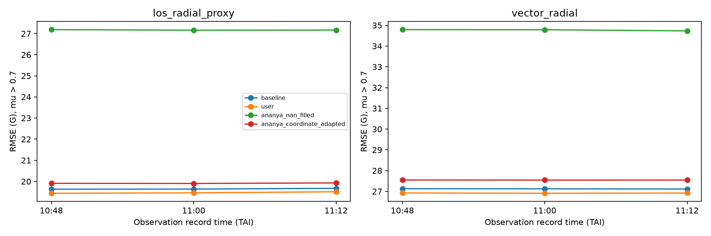
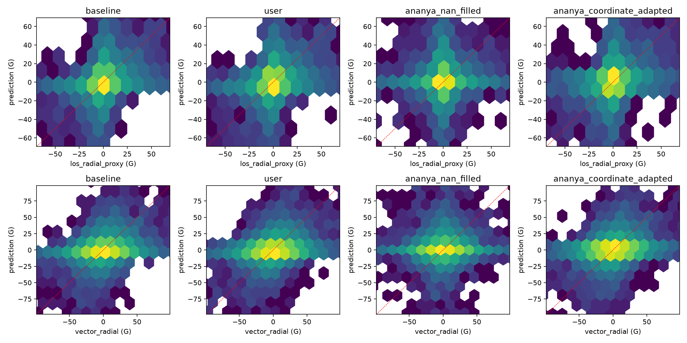
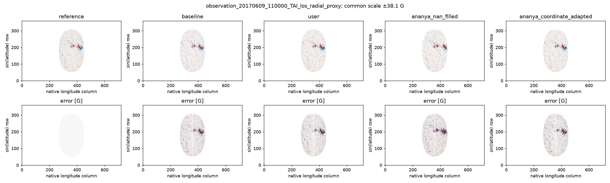
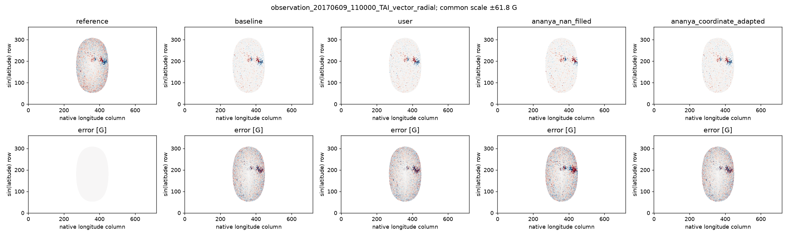
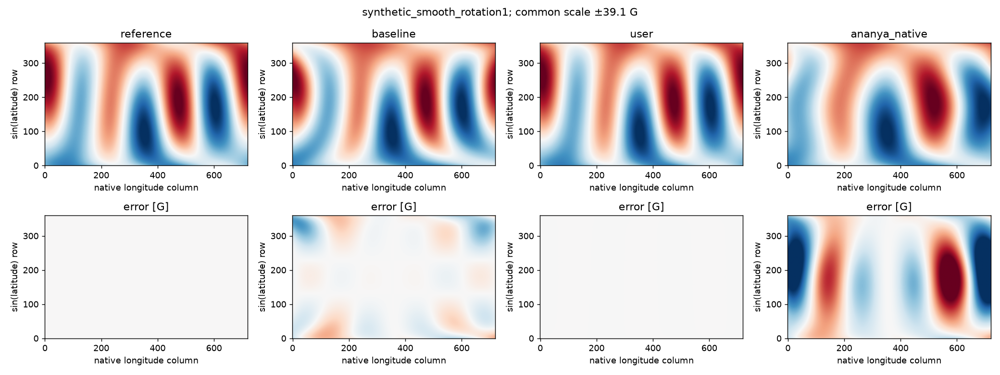
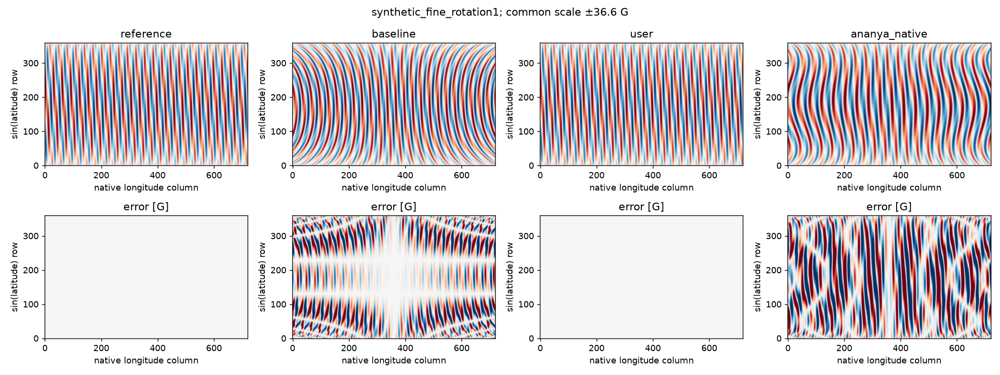
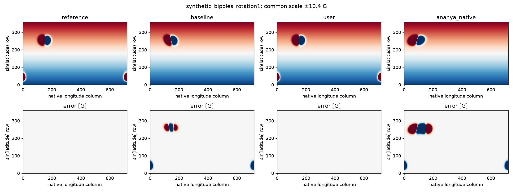

# Pre-SFT reconstruction accuracy: synthetic tests and HMI observations

> **Current project paths:** The reconstruction is now
> `my work/pre_sft_reconstruction/reconstruct_synoptic_map.py`, shared FITS data
> are in `my work/hmi_fits_data/`, and the observation downloader is
> `my work/download_cr2191_hmi_observations.py`. The comparison archive is now
> inside `my work/pre_sft_reconstruction/`. Historical paths and source hashes
> below describe the files as audited; the reconstruction's only code change
> during this reorganization is its data-directory path. Scientific findings,
> numerical tables, and plots are unchanged.

Completed 12 November 2026. All numerical results were calculated anew from original code and FITS/record metadata. No previous audit, experiment, report, or result was consulted. Neither original implementation was edited. The full SFT simulation was never run.

## Findings

The user's implementation is decisively more accurate in the specified ideal differential-rotation synthetic model. It also has lower observational RMSE than the operational, NaN-filled Ananya implementation on all three near-reference observations. This is **not** a universal physical accuracy claim: the advantage over the original synoptic map is small on observations, changes with the region and metric, and is affected by observational construction and the synoptic product's own temporal averaging.

The literal Ananya reconstruction has **zero finite output pixels** on the real FITS inputs because NaNs enter its global tensor cubic splines. Consequently, a literal observational RMSE comparison is undefined. All quoted finite observational comparisons to Ananya use adaptations explicitly listed below; zero valid pixels never means zero error.

At 11:00 TAI, los_radial_proxy: user's RMSE **19.4594 G**, versus **27.1612 G** for NaN-filled Ananya: **7.7018 G (28.36%) lower**. Baseline RMSE is **19.6368 G**, an improvement of **0.1773 G (0.90%)**. After correcting Ananya's coordinate interpretation, RMSE is 19.9033 G; user's remaining advantage is 2.23%.

At 11:00 TAI, vector_radial: user's RMSE **26.9067 G**, versus **34.7877 G** for NaN-filled Ananya: **7.8810 G (22.65%) lower**. Baseline RMSE is **27.1224 G**, an improvement of **0.2157 G (0.80%)**. After correcting Ananya's coordinate interpretation, RMSE is 27.5434 G; user's remaining advantage is 2.31%.

The region results are mixed against the baseline. At 11:00 TAI, the user's disk-center (mu>0.9) RMSE is 14.814 G for the LOS proxy and 17.524 G for the vector reference, versus 15.388 G and 18.032 G for the baseline. In contrast, on the strong-vector-reference subset (1,159 cells), user RMSE is **112.270 G versus 111.962 G** for the baseline: a slight worsening. On the strong-LOS subset, MAE also worsens despite a small RMSE reduction. The majority-high-confidence subset has only 38 cells at this time, while the strict all-subpoint high-confidence subset is empty. These small/empty samples do not independently establish vector accuracy.

## Inputs, preservation, and execution boundary

Inputs are the 360×720 HMI radial synoptic FITS maps CR2190, CR2191, and CR2192; and the 10:48, 11:00, and 11:12 TAI records in `fits_files/observations/cr2191`. All three synoptic rotations are actually used as source data. All three observation times are independently decoded. The reference time in CR2191's header is 2017-06-09 10:56:34 TAI. Record QUALITY values, observer longitudes, and exact observation times are retained in the consolidation appendix below.

Both original implementation files remain in their original project locations. Two sets of analysis-only source snapshots were verified byte-for-byte against them. The snapshots, runtime environment, and raw-input hashes are optional reproducibility artifacts; the source identifiers, input description, numerical validation outcomes, and analysis methodology are preserved here. The approved cleanup was subsequently completed; only the retained report, numerical tables, and plots remain in this archive.

Only `pre-sft/main.py` is imported. From `SFT.py`, only the AST of its `omega` function is executed. Its reconstruction expressions are reproduced with batch evaluation of the same SciPy tensor spline, validated against scalar calls. No SFT grid initialization, curl calculation, flow integration, flux emergence, or time stepping is executed. The evaluated endpoint is Ananya's `B_day106` versus the user's `B_new`, before the later SFT-specific grid conversion. Those names are historical; all inputs here are CR2190–2192.

## Coordinates, adaptations, and common masks

All scoring uses CR2191's physical 720×360 grid: 0.5° longitude and approximately 1/180 in sin(latitude). Latitude is arcsin of the FITS second-axis coordinate; colatitude is 90° minus latitude. HMI's known synoptic longitude sign convention is handled using positive longitude increments, as in the user's original and the [SunPy HMI synoptic source documentation](https://docs.sunpy.org/en/stable/generated/api/sunpy.map.sources.HMISynopticMap.html). The slight FITS CDELT2 rounding is retained identically across methods. Pixels have equal spherical area to that precision, so unweighted grid metrics are area metrics.

| Name | Treatment |
|---|---|
| baseline | Original CR2191 array, no reconstruction. |
| user | Actual imported reconstruction functions, unchanged. Synthetic inputs replace only arrays/splines temporarily. |
| ananya_native | Original linspace longitude endpoints, arcsin latitude supplied directly to the colatitude rotation function, original plus-sign mapping and previous/next branching. Only file inputs and vectorized evaluation are adapted. Outputs retain their original array indices on the common physical grid, exposing rather than concealing coordinate errors. |
| ananya_nan_filled | Same algorithm as native, with missing source pixels filled by nearest finite pixel in array-index Euclidean distance before global spline construction. This is an operational adaptation, not original-code behavior. |
| ananya_coordinate_adapted | Additional diagnostic: use actual FITS latitude/longitude centers and colatitude in omega. Retain original mapping sign, denominator, and previous/next branches. Not a claim about Ananya's original accuracy. |

For every case and region, all finite operational methods and the baseline are scored on the **intersection** of finite prediction/reference pixels and the same geometric mask. The unusable literal Ananya output is excluded from constructing the operational common mask and is separately reported with N=0. Synthetic inputs have no NaNs, so the literal Ananya output participates normally. No method is scored against a different truth. The numerical tables retain sample counts and all calculated metrics; the common masks and region rules are described here. The NPZ arrays preserve pixel-level values but are optional for this analysis archive.

The user's real reconstruction has 258,676 finite cells; the baseline has 258,754. The NaN-filled adaptations have 259,200. Common masking prevents a method from benefiting from scoring easier pixels alone, although missing-data imputation can influence nearby spline values. Nearest filling is not a physically validated gap-recovery method.

## Synthetic ground truth and results

Truth is an analytic field F(longitude, latitude) at t=0, evaluated independently of either reconstruction. At unwrapped source longitude s, the idealized synoptic acquisition time is t(s)=(180−s)/13.2 days. For rotation rate w(latitude), the synthetic source map is F(s−w t(s), latitude). CR2190 uses s=longitude+360; CR2192 uses s=longitude−360. Truth and source arrays are evaluated analytically, not generated by running or inverting either reconstruction's code.

Solving the continuous forward observation relation gives source longitude s=phi−w(phi−180)/(13.2+w). This is the user's implemented mapping. Thus, these tests establish numerical correctness **conditional on that physical acquisition/advection model**, not independent evidence that the Sun or this preprocessed HMI product obeys it exactly. Ananya's plus-sign relation and latitude interpretation are distinct hypotheses.

Four fields are tested: a constant field; smooth low-order longitude/latitude structure; modes up to longitudinal order 47; and localized bipolar/longitude-seam features. Each is tested with the nominal law, zero rotation (static truth), and 70% of the nominal rate. Additional tests add independently generated 3 G source noise across three fixed RNG realizations, and exponential amplitude evolution of 2.5% per day. All share the same exact truth per case. The latter tests expose model mismatch rather than silently assuming perfect advection.

### Nominal-law synthetic accuracy

| Case / region | Model | N | RMSE (G) | MAE (G) | Pearson r | Bias (G) |
|---|---|---:|---:|---:|---:|---:|
| constant_rotation1 / all | baseline | 259200 | 0 | 0 | — | 0 |
| constant_rotation1 / all | user | 259200 | 0 | 0 | — | 0 |
| constant_rotation1 / all | ananya_native | 259200 | 1.82959e-15 | 1.43043e-15 | — | -1.32521e-16 |
| smooth_rotation1 / all | baseline | 259200 | 4.92848 | 2.98753 | 0.96852 | -0.544264 |
| smooth_rotation1 / all | user | 259200 | 1.125e-08 | 7.24393e-09 | 1 | -2.70638e-10 |
| smooth_rotation1 / all | ananya_native | 259200 | 20.1412 | 14.411 | 0.468669 | -2.08918 |
| fine_rotation1 / all | baseline | 259200 | 18.4017 | 12.9862 | 0.515878 | 0.011928 |
| fine_rotation1 / all | user | 259200 | 0.000288418 | 0.000206709 | 1 | -5.9898e-07 |
| fine_rotation1 / all | ananya_native | 259200 | 26.3026 | 20.4545 | 0.0117251 | -0.00231182 |
| bipoles_rotation1 / all | baseline | 259200 | 4.79137 | 0.579554 | 0.884946 | -0.270533 |
| bipoles_rotation1 / all | user | 259200 | 1.84848e-06 | 2.02352e-07 | 1 | 1.10584e-09 |
| bipoles_rotation1 / all | ananya_native | 259200 | 13.4335 | 2.14774 | 0.157718 | -0.248212 |

### Static and mismatched-rate conditions

| Case / region | Model | N | RMSE (G) | MAE (G) | Pearson r | Bias (G) |
|---|---|---:|---:|---:|---:|---:|
| smooth_rotation0 / all | baseline | 259200 | 0 | 0 | 1 | 0 |
| smooth_rotation0 / all | user | 259200 | 5.33773 | 3.197 | 0.964269 | 0.428182 |
| smooth_rotation0 / all | ananya_native | 259200 | 18.8798 | 12.1937 | 0.53787 | -1.90259 |
| smooth_rotation0.7 / all | baseline | 259200 | 3.48776 | 2.10532 | 0.984402 | -0.423778 |
| smooth_rotation0.7 / all | user | 259200 | 1.73735 | 1.01452 | 0.996227 | 0.2012 |
| smooth_rotation0.7 / all | ananya_native | 259200 | 19.7091 | 13.7916 | 0.492163 | -2.10408 |
| bipoles_rotation0 / all | baseline | 259200 | 0 | 0 | 1 | 0 |
| bipoles_rotation0 / all | user | 259200 | 6.78779 | 1.01328 | 0.782433 | 0.200969 |
| bipoles_rotation0 / all | ananya_native | 259200 | 13.6993 | 2.10531 | 0.116601 | -0.243 |
| bipoles_rotation0.7 / all | baseline | 259200 | 4.25329 | 0.484861 | 0.909474 | -0.268694 |
| bipoles_rotation0.7 / all | user | 259200 | 3.96802 | 0.455331 | 0.927258 | 0.211056 |
| bipoles_rotation0.7 / all | ananya_native | 259200 | 13.5224 | 2.13832 | 0.144436 | -0.248922 |

### Source noise and intrinsic evolution

| Case / region | Model | N | RMSE (G) | MAE (G) | Pearson r | Bias (G) |
|---|---|---:|---:|---:|---:|---:|
| noise3G_seed0 / all | baseline | 259200 | 5.66394 | 2.89471 | 0.845137 | -0.267073 |
| noise3G_seed0 / all | user | 259200 | 2.80815 | 2.23672 | 0.963737 | 0.00364001 |
| noise3G_seed0 / all | ananya_native | 259200 | 13.721 | 4.25033 | 0.152636 | -0.241529 |
| noise3G_seed1 / all | baseline | 259200 | 5.65687 | 2.89529 | 0.845491 | -0.269 |
| noise3G_seed1 / all | user | 259200 | 2.80989 | 2.23842 | 0.963699 | 0.00253323 |
| noise3G_seed1 / all | ananya_native | 259200 | 13.7128 | 4.24793 | 0.15355 | -0.248088 |
| noise3G_seed2 / all | baseline | 259200 | 5.66013 | 2.89789 | 0.845273 | -0.266585 |
| noise3G_seed2 / all | user | 259200 | 2.80843 | 2.2386 | 0.963709 | 0.00100851 |
| noise3G_seed2 / all | ananya_native | 259200 | 13.7082 | 4.24753 | 0.154058 | -0.243799 |
| evolution_2.5pct_per_day / all | baseline | 259200 | 5.51253 | 1.48762 | 0.874885 | -0.232445 |
| evolution_2.5pct_per_day / all | user | 259200 | 2.56278 | 1.19967 | 0.983561 | 0.0397459 |
| evolution_2.5pct_per_day / all | ananya_native | 259200 | 15.0705 | 3.09353 | 0.117825 | -0.199858 |

A static field favors the unremapped baseline, which has exactly zero error. Neither remapping is universally superior to leaving the map unchanged. Source noise cannot be removed by pure interpolation; intrinsic emergence/decay cannot be undone by a rotation-only reconstruction. Low-latitude, mid-latitude, polar, and seam metrics for every primary synthetic case are retained in [all_metrics.csv](synthetic_and_observational_accuracy_metrics.csv).

## Observational reference construction

The original FITS segments contain image data but no complete image WCS; record JSON keywords supply WCS and ephemerides. A separate SunPy map is built for each instrument record using its own T_OBS, observer, camera orientation, and pixel geometry. TAI is explicitly retained. Carrington coordinates on the shared grid are transformed to each observation's image coordinates. Compressed images are decoded freshly.

The primary spatial averaging is **8×8 equal-area quadrature per CEA pixel**. At each subpoint, image components are bilinearly sampled, projected, and then averaged. This applies the same target spatial scale to both references and all reconstructed maps. It approximates a pixel-area average; it is not an exact reproduction of HMI's synoptic-map processing or PSF. Only cells with every quadrature subpoint finite and safely on disk are eligible. Primary regions require averaged mu>0.7; the disk-center sensitivity region requires mu>0.9. A strong-reference region requires |reference Br|>50 G and is defined separately for each reference, consistently for all methods within that reference.

Two observation references are kept separate:

1. **LOS radial proxy:** the observed HMI M_720s magnetogram divided by the local normal–observer-ray cosine mu. Valid only to the extent that the local field is radial; it is not vector ground truth.
2. **Vector radial reference:** disambiguate the HMI B_720s azimuth, construct image-frame components Bxi=−B sin(inclination) sin(azimuth), Beta=B sin(inclination) cos(azimuth), Bzeta=B cos(inclination), project the surface normal into the local observer-ray tangent basis, rotate to the CCD basis, and take the dot product. The finite observer distance and camera rotation are included. Disambiguation uses **bit 2**, the radial acute-angle solution in weak pixels; high-confidence pixels use minimum energy. This weak-field radial prior limits its independence from the LOS proxy. Conventions and confidence interpretation follow the [HMI vector pipeline paper, Appendix A](https://arxiv.org/abs/1404.1881) and the [HMI coordinate technical note](https://arxiv.org/abs/1309.2392).

The `high_confidence` sensitivity region requires at least 50% of quadrature points to have CONF_DISAMBIG≥90 and all sampled CONV_FLAG values to be zero. This is explicitly a cell-majority selection; the whole pixel reference still includes its weaker subpoints. `strict_high_confidence` requires every subpoint high confidence and is reported even if empty. Small N and empty subsets must not support a global conclusion.

The observations are near, rather than exactly at, the synoptic reference time. They are compared at fixed Carrington coordinates without transporting them with either candidate rotation law, avoiding a model-dependent observational truth. Their minutes-scale time offsets and 720 s temporal averaging remain limitations; the synoptic data span weeks and have much larger intrinsic timing uncertainty.

### Primary observational metrics, all three times

| Case / region | Model | N | RMSE (G) | MAE (G) | Pearson r | Bias (G) |
|---|---|---:|---:|---:|---:|---:|
| 20170609_104800_TAI_los_radial_proxy / mu_gt_0.7 | baseline | 38536 | 19.6325 | 7.31899 | 0.45334 | 0.015723 |
| 20170609_104800_TAI_los_radial_proxy / mu_gt_0.7 | user | 38536 | 19.4376 | 7.3195 | 0.457747 | 0.0101972 |
| 20170609_104800_TAI_los_radial_proxy / mu_gt_0.7 | ananya_native | 0 | — | — | — | — |
| 20170609_104800_TAI_los_radial_proxy / mu_gt_0.7 | ananya_nan_filled | 38536 | 27.1885 | 8.97372 | -0.0531013 | 0.754454 |
| 20170609_104800_TAI_los_radial_proxy / mu_gt_0.7 | ananya_coordinate_adapted | 38536 | 19.9089 | 7.48209 | 0.425266 | 0.0224184 |
| 20170609_104800_TAI_vector_radial / mu_gt_0.7 | baseline | 38536 | 27.1283 | 15.4452 | 0.381894 | -0.402754 |
| 20170609_104800_TAI_vector_radial / mu_gt_0.7 | user | 38536 | 26.9232 | 15.3982 | 0.388934 | -0.40828 |
| 20170609_104800_TAI_vector_radial / mu_gt_0.7 | ananya_native | 0 | — | — | — | — |
| 20170609_104800_TAI_vector_radial / mu_gt_0.7 | ananya_nan_filled | 38536 | 34.793 | 17.3381 | -0.0596788 | 0.335977 |
| 20170609_104800_TAI_vector_radial / mu_gt_0.7 | ananya_coordinate_adapted | 38536 | 27.5493 | 15.5918 | 0.353955 | -0.396059 |
| 20170609_110000_TAI_los_radial_proxy / mu_gt_0.7 | baseline | 38547 | 19.6368 | 7.32139 | 0.452973 | 0.0315792 |
| 20170609_110000_TAI_los_radial_proxy / mu_gt_0.7 | user | 38547 | 19.4594 | 7.31547 | 0.456365 | 0.0268843 |
| 20170609_110000_TAI_los_radial_proxy / mu_gt_0.7 | ananya_native | 0 | — | — | — | — |
| 20170609_110000_TAI_los_radial_proxy / mu_gt_0.7 | ananya_nan_filled | 38547 | 27.1612 | 8.95655 | -0.0526547 | 0.782475 |
| 20170609_110000_TAI_los_radial_proxy / mu_gt_0.7 | ananya_coordinate_adapted | 38547 | 19.9033 | 7.4811 | 0.425416 | 0.0387868 |
| 20170609_110000_TAI_vector_radial / mu_gt_0.7 | baseline | 38547 | 27.1224 | 15.421 | 0.38236 | -0.360088 |
| 20170609_110000_TAI_vector_radial / mu_gt_0.7 | user | 38547 | 26.9067 | 15.3559 | 0.389925 | -0.364782 |
| 20170609_110000_TAI_vector_radial / mu_gt_0.7 | ananya_native | 0 | — | — | — | — |
| 20170609_110000_TAI_vector_radial / mu_gt_0.7 | ananya_nan_filled | 38547 | 34.7877 | 17.2892 | -0.0600379 | 0.390808 |
| 20170609_110000_TAI_vector_radial / mu_gt_0.7 | ananya_coordinate_adapted | 38547 | 27.5434 | 15.5656 | 0.354425 | -0.35288 |
| 20170609_111200_TAI_los_radial_proxy / mu_gt_0.7 | baseline | 38526 | 19.6738 | 7.32153 | 0.451399 | 0.036715 |
| 20170609_111200_TAI_los_radial_proxy / mu_gt_0.7 | user | 38526 | 19.5106 | 7.33107 | 0.453997 | 0.030073 |
| 20170609_111200_TAI_los_radial_proxy / mu_gt_0.7 | ananya_native | 0 | — | — | — | — |
| 20170609_111200_TAI_los_radial_proxy / mu_gt_0.7 | ananya_nan_filled | 38526 | 27.1671 | 8.95953 | -0.0523828 | 0.794349 |
| 20170609_111200_TAI_los_radial_proxy / mu_gt_0.7 | ananya_coordinate_adapted | 38526 | 19.9289 | 7.48223 | 0.424487 | 0.0431187 |
| 20170609_111200_TAI_vector_radial / mu_gt_0.7 | baseline | 38526 | 27.1126 | 15.3743 | 0.38209 | -0.332511 |
| 20170609_111200_TAI_vector_radial / mu_gt_0.7 | user | 38526 | 26.9194 | 15.3346 | 0.388515 | -0.339153 |
| 20170609_111200_TAI_vector_radial / mu_gt_0.7 | ananya_native | 0 | — | — | — | — |
| 20170609_111200_TAI_vector_radial / mu_gt_0.7 | ananya_nan_filled | 38526 | 34.7326 | 17.2555 | -0.0576326 | 0.425123 |
| 20170609_111200_TAI_vector_radial / mu_gt_0.7 | ananya_coordinate_adapted | 38526 | 27.5455 | 15.5335 | 0.353526 | -0.326107 |

### Region sensitivity at 11:00 TAI

| Case / region | Model | N | RMSE (G) | MAE (G) | Pearson r | Bias (G) |
|---|---|---:|---:|---:|---:|---:|
| 20170609_110000_TAI_los_radial_proxy / mu_gt_0.9 | baseline | 12789 | 15.3883 | 6.13874 | 0.583834 | 0.0703096 |
| 20170609_110000_TAI_los_radial_proxy / mu_gt_0.9 | user | 12789 | 14.8136 | 6.05753 | 0.608962 | 0.0653378 |
| 20170609_110000_TAI_los_radial_proxy / mu_gt_0.9 | ananya_native | 0 | — | — | — | — |
| 20170609_110000_TAI_los_radial_proxy / mu_gt_0.9 | ananya_nan_filled | 12789 | 22.1025 | 8.06137 | 0.11498 | -0.307483 |
| 20170609_110000_TAI_los_radial_proxy / mu_gt_0.9 | ananya_coordinate_adapted | 12789 | 15.6225 | 6.25793 | 0.565873 | 0.066549 |
| 20170609_110000_TAI_los_radial_proxy / strong_reference | baseline | 544 | 106.806 | 83.7796 | 0.647822 | -3.87195 |
| 20170609_110000_TAI_los_radial_proxy / strong_reference | user | 544 | 106.49 | 84.455 | 0.648773 | -2.11106 |
| 20170609_110000_TAI_los_radial_proxy / strong_reference | ananya_native | 0 | — | — | — | — |
| 20170609_110000_TAI_los_radial_proxy / strong_reference | ananya_nan_filled | 544 | 174.313 | 128.191 | -0.112015 | 14.7694 |
| 20170609_110000_TAI_los_radial_proxy / strong_reference | ananya_coordinate_adapted | 544 | 111.503 | 88.7042 | 0.609323 | -4.7005 |
| 20170609_110000_TAI_los_radial_proxy / high_confidence | baseline | 38 | 192.63 | 171.443 | 0.762525 | 20.007 |
| 20170609_110000_TAI_los_radial_proxy / high_confidence | user | 38 | 190.695 | 168.838 | 0.778854 | 21.656 |
| 20170609_110000_TAI_los_radial_proxy / high_confidence | ananya_native | 0 | — | — | — | — |
| 20170609_110000_TAI_los_radial_proxy / high_confidence | ananya_nan_filled | 38 | 295.983 | 272.397 | -0.0235923 | 27.4436 |
| 20170609_110000_TAI_los_radial_proxy / high_confidence | ananya_coordinate_adapted | 38 | 211.806 | 195.438 | 0.754098 | 19.513 |
| 20170609_110000_TAI_los_radial_proxy / strict_high_confidence | baseline | 0 | — | — | — | — |
| 20170609_110000_TAI_los_radial_proxy / strict_high_confidence | user | 0 | — | — | — | — |
| 20170609_110000_TAI_los_radial_proxy / strict_high_confidence | ananya_native | 0 | — | — | — | — |
| 20170609_110000_TAI_los_radial_proxy / strict_high_confidence | ananya_nan_filled | 0 | — | — | — | — |
| 20170609_110000_TAI_los_radial_proxy / strict_high_confidence | ananya_coordinate_adapted | 0 | — | — | — | — |
| 20170609_110000_TAI_vector_radial / mu_gt_0.9 | baseline | 12789 | 18.0322 | 9.67668 | 0.543506 | -0.351181 |
| 20170609_110000_TAI_vector_radial / mu_gt_0.9 | user | 12789 | 17.5236 | 9.55761 | 0.56627 | -0.356153 |
| 20170609_110000_TAI_vector_radial / mu_gt_0.9 | ananya_native | 0 | — | — | — | — |
| 20170609_110000_TAI_vector_radial / mu_gt_0.9 | ananya_nan_filled | 12789 | 24.6239 | 11.7052 | 0.112682 | -0.728973 |
| 20170609_110000_TAI_vector_radial / mu_gt_0.9 | ananya_coordinate_adapted | 12789 | 18.2771 | 9.75321 | 0.526935 | -0.354942 |
| 20170609_110000_TAI_vector_radial / strong_reference | baseline | 1159 | 111.962 | 85.5009 | 0.527516 | -0.751638 |
| 20170609_110000_TAI_vector_radial / strong_reference | user | 1159 | 112.27 | 85.5023 | 0.525419 | -0.129551 |
| 20170609_110000_TAI_vector_radial / strong_reference | ananya_native | 0 | — | — | — | — |
| 20170609_110000_TAI_vector_radial / strong_reference | ananya_nan_filled | 1159 | 155.07 | 112.695 | -0.122025 | 9.2525 |
| 20170609_110000_TAI_vector_radial / strong_reference | ananya_coordinate_adapted | 1159 | 115.647 | 88.5204 | 0.486975 | -1.82268 |
| 20170609_110000_TAI_vector_radial / high_confidence | baseline | 38 | 291.644 | 271.079 | 0.721011 | 27.1466 |
| 20170609_110000_TAI_vector_radial / high_confidence | user | 38 | 286.468 | 267.347 | 0.757686 | 28.7955 |
| 20170609_110000_TAI_vector_radial / high_confidence | ananya_native | 0 | — | — | — | — |
| 20170609_110000_TAI_vector_radial / high_confidence | ananya_nan_filled | 38 | 393.466 | 377.164 | -0.0199991 | 34.5832 |
| 20170609_110000_TAI_vector_radial / high_confidence | ananya_coordinate_adapted | 38 | 312.565 | 298.838 | 0.721127 | 26.6525 |
| 20170609_110000_TAI_vector_radial / strict_high_confidence | baseline | 0 | — | — | — | — |
| 20170609_110000_TAI_vector_radial / strict_high_confidence | user | 0 | — | — | — | — |
| 20170609_110000_TAI_vector_radial / strict_high_confidence | ananya_native | 0 | — | — | — | — |
| 20170609_110000_TAI_vector_radial / strict_high_confidence | ananya_nan_filled | 0 | — | — | — | — |
| 20170609_110000_TAI_vector_radial / strict_high_confidence | ananya_coordinate_adapted | 0 | — | — | — | — |

## Metric definitions and interpretation

Error e=prediction−reference, in gauss. RMSE=sqrt(mean(e²)); MAE=mean(|e|); bias=mean(e). Pearson correlation measures linear structure agreement and is undefined for constant fields. `nrmse_std` divides RMSE by the reference standard deviation. Also saved are 95th-percentile absolute error, sign agreement, reference RMS, predicted/reference means, and unsigned-field ratio. Sign agreement near zero field is noise-sensitive. Unsigned ratio is a partial-area unsigned-flux ratio on these equal-area cells, not a whole-Sun flux measurement. All metrics are descriptive; no independence-based significance claim is made for correlated pixels or the three closely spaced observations.

## Limitations and inconclusive findings

- **There is no observed instantaneous full-Sun radial ground truth.** The far side, polar reconstruction, and most seam behavior can be validated synthetically here but not from these three disk images.
- The synoptic FITS header declares CARSTRCH=1, differential-rotation coefficients, and a 15° longitudinal half-width. These inputs already incorporate temporal/spatial processing and rotation stretching. A model of ideal instantaneous central-meridian strips is not a complete model of this product. Comparisons against observations test end-product agreement, not isolated interpolation correctness.
- The LOS reference assumes radial fields. The vector reference has inversion noise, weak-field disambiguation priors, and calibration systematics. Both come from HMI and may share observations underlying the synoptic product; this is not a statistically independent instrument holdout.
- Supplied per-pixel field/angular error and covariance segments were not propagated. No calibrated chi-square, uncertainty interval, or claim of statistically significant superiority is justified. Correlation is modest, and residuals include genuine solar evolution, source-product mismatch, observational noise, and reconstruction error.
- Common masks remove missing output cells but cannot undo the influence of filling on global splines. Native Ananya cannot be ranked numerically on actual missing-data inputs; finite comparisons necessarily concern its adapted versions.
- The coordinate-adapted diagnostic removes much of Ananya's observational deficit. Therefore the large native-versus-user gap cannot be attributed solely to the time-remapping equation.
- The original synoptic baseline is competitive. Any claim that reconstruction substantially improves real radial-field accuracy would require many rotations, more observation dates, independent references, matched instrument smoothing, and uncertainty-aware validation. The present evidence supports conditional synthetic correctness and a small descriptive observational RMSE advantage, not universal superiority.

## Preserved numerical tables and figures

This archive prioritizes the analysis and its results. It does not require retaining rerun scripts, raw observations, pixel arrays, source snapshots, package lock information, or intermediate logs. Their essential methodological details and validation outcomes are consolidated in this report.

- [all_metrics.csv](synthetic_and_observational_accuracy_metrics.csv): **342 rows**, comprising 330 primary-run rows and 12 noise/evolution rows, with all 16 recorded columns at their original numeric precision.
- [quadrature4/metrics.csv](spatial_averaging_sensitivity_4x4/accuracy_metrics_4x4_spatial_averaging.csv): **330 rows**, retaining every result of the independently sampled 4×4 averaging sensitivity run, including all times and regions. Synthetic results repeat the main run exactly; observational results differ and must be preserved.

Both tables preserve `case`, `region`, `model`, `n`, `truth_valid`, `rmse`, `mae`, `bias`, `correlation`, `nrmse_std`, `p95_abs_error`, `sign_agreement`, `truth_rms`, `prediction_mean`, `truth_mean`, and `unsigned_ratio`. Empty metric cells mean undefined or unscorable, not zero. `truth_valid` counts finite eligible reference pixels before prediction-intersection masking; `n` is the scored intersection. These CSVs preserve every JSON numerical result, including cases and regions not repeated in the shorter narrative tables.

### Observational comparisons









### Nominal synthetic comparisons







Map-panel rows use a shared symmetric color range stated in each figure title; the bottom row is prediction minus reference. Horizontal coordinates are native longitude-column indices, and vertical coordinates are CEA row indices increasing with sin(latitude). The scatter plots show logarithmic density and clip displayed axes at a 99th-percentile absolute-field scale; the numerical metrics use all valid scored pixels, including outliers outside the displayed range. Correlation and bias conclusions must be read from the numerical tables rather than inferred solely from these clipped plots.

## Spatial averaging sensitivity: 4×4 versus 8×8

| Reference at 11:00 | Model | 4×4 RMSE | 8×8 RMSE | Difference (G) |
|---|---|---:|---:|---:|
| los_radial_proxy | baseline | 19.78795 | 19.63676 | -0.15119 |
| los_radial_proxy | user | 19.62139 | 19.45941 | -0.16198 |
| los_radial_proxy | ananya_nan_filled | 27.30242 | 27.16122 | -0.14119 |
| los_radial_proxy | ananya_coordinate_adapted | 20.06263 | 19.90327 | -0.15936 |
| vector_radial | baseline | 27.64955 | 27.12241 | -0.52713 |
| vector_radial | user | 27.43520 | 26.90667 | -0.52853 |
| vector_radial | ananya_nan_filled | 35.21659 | 34.78768 | -0.42891 |
| vector_radial | ananya_coordinate_adapted | 28.06321 | 27.54339 | -0.51982 |

These calculations use independently sampled quadratures, with the same selection rules. Their masks can differ slightly at thresholds. This tests sensitivity, not a proof of numerical convergence or exact agreement with the instrument PSF. Interpret improvements comparable to sampling changes cautiously.

## Consolidated methodology details

The following details were recovered from the calculation scripts and metadata so that deleting those artifacts does not remove the analysis definition.

### Reconstruction equations and interpolation

Let phi be destination Carrington longitude in degrees and theta be colatitude. The differential rotation law relative to the reference frame is

`w(theta) = 0.18 − 2.3 cos(theta)^2 − 1.62 cos(theta)^4` degrees/day.

The user's algorithm uses `delta_t=(phi−180)/(13.2+w)` and `phi_source=phi−w*delta_t`. At each unchanged latitude, it sorts the physical longitude centers and constructs one extended longitude axis with Next CR at longitude−360, Current CR at longitude, and Previous CR at longitude+360. CubicSpline uses the default not-a-knot boundary condition, with extrapolation disabled. Splines are built separately for contiguous finite runs of at least four pixels; missing spans remain missing. Longitude is interpolated and latitude is not remapped. There is no imposed single-map periodicity and no meridional flow or diffusion in this reconstruction.

Ananya's original axis is `p=linspace(0,360,720)` including both endpoints, with `a=arcsin(linspace(−1,1,360))`. It evaluates the same rotation polynomial at `a` directly, although that polynomial is intended for colatitude, and uses `p_source=p+w(a)*(p−180)/13.2`. Its tensor-product cubic RectBivariateSpline is evaluated at the same latitude-axis row and mapped longitude. Sources below 0 select Previous CR after adding 360; sources above 360 select Next CR after subtracting 360; values exactly on 0 or 360 stay in Current CR. The rotation function's original radian/second conversion cancels against the reference angular velocity in this ratio. The coordinate-adapted diagnostic substitutes the actual physical pixel centers and evaluates w at colatitude, but retains this mapping and branch order.

### Exact synthetic fields and stress-test definitions

All fields are in gauss. Let `x=radians(p)`, `y=radians(latitude)`, and `d_c(p)=((p−c+180) mod 360)−180`, with p and latitude in degrees:

```text
constant: F = 7
smooth:   F = 15 sin(y) + 30 cos(y)^2 cos(3x) + 12 sin(2x+2y)
fine:     F = 30 cos(y) sin(24x+3y) + 10 cos(47x−y)
bipoles:  F = 200 exp(−d_70(p)^2/100 − (latitude−25)^2/36)
              − 180 exp(−d_80(p)^2/100 − (latitude−25)^2/36)
              + 100 exp(−d_359(p)^2/49 − (latitude+50)^2/64)
              + 10 sin(y)
```

For rotation factors f=0, 1, and 0.7, source values are `F(s−f*w*t(s),latitude)`; the reconstruction itself always assumes its nominal rotation law. Noise tests add independent zero-mean Gaussian noise with standard deviation 3 G to each source map. A single NumPy generator initialized with 219019192 produces three sequential independent realizations labeled seed0–seed2; those labels are realization indices, not separate generator seeds. The evolution test multiplies nominal advected source values by `exp(0.025*t(s))`. This is an exponential rate of 0.025/day, approximately 2.5% daily growth, without adding any temporal correction to either reconstruction.

Synthetic region rules are: all finite grid cells; low latitude |latitude|<30°; mid latitude 30°≤|latitude|<60°; polar |latitude|≥60°; seam longitude<20° or longitude>340°. In this study there are 12 primary synthetic cases, each with five regions and three models (180 rows), plus four supplemental cases with three models each (12 rows). The observational primary run has three times, two references, five regions, and five model labels (150 rows). Thus the primary table has 342 rows; the separate averaging-sensitivity table has 330 rows.

### Observation geometry and validity details

The target subpixel offsets in either CEA coordinate are `(i+0.5)/Q−0.5`, for i=0…Q−1 and Q=8 or Q=4. Longitude offsets multiply 0.5°; latitude offsets multiply the FITS sin(latitude) increment before arcsin. At each subpoint, the reference is accepted only when both LOS and vector-derived values are finite and mu>0.3. A target cell requires every subpoint accepted. Both reference types therefore start from a joint observation-valid mask. Primary and regional mu thresholds operate on the average subpoint mu, rather than requiring every subpoint exceed 0.7 or 0.9. Confidence and convergence flags use nearest-neighbor sampling; magnetic components use bilinear sampling with no off-image extrapolation. The primary mu>0.7 sample counts are equal for both references and all operational methods at each time.

For the LOS proxy, mu is the surface normal dot the observer-facing ray, including finite spacecraft distance. Writing d=observer distance/solar radius and nz for the surface normal component toward the observer-centered z axis, `mu=(d*nz−1)/sqrt(d^2+1−2*d*nz)`. Vector conversion projects the normal into the local helioprojective ray basis, rotates its transverse components with the camera rotation matrix, then contracts with the image-frame magnetic vector. Vector bits and angles are applied before component interpolation, and projection occurs before target-pixel averaging.

Main masks do not require high confidence or convergence; those are sensitivity subsets. `high_confidence` requires at least half the subpoints at confidence 90 and every sampled convergence flag zero. `strict_high_confidence` requires average confidence at least 90 (equivalently all sampled flags at that maximum) and every convergence flag zero. The references and all variants are compared on the operational prediction intersection after these rules.

### Source identity, observation metadata, and numerical checks

CR2191 grid metadata: `CRVAL1=788580.0`, `CRPIX1=360.4`, `CDELT1=-0.5`, `CRVAL2=0.0`, `CRPIX2=180.5`, `CDELT2=0.005556`. The effective longitude increment is abs(CDELT1).

| Observation (TAI, same actual time for M and B) | Offset from reference | Observer Carrington longitude | QUALITY (M and B) | Scored primary cells |
|---|---:|---:|---|---:|
| 2017.06.09_10:48:08_TAI | −8 min 26 s | 180.130768° | 0x00000000 | 38536 |
| 2017.06.09_11:00:08_TAI | +3 min 34 s | 180.020935° | 0x00000000 | 38547 |
| 2017.06.09_11:12:08_TAI | +15 min 34 s | 179.911072° | 0x00000000 | 38526 |

Camera rotation matrices (rows as recorded):

- 20170609_104800_TAI: `[[-0.9999999726636924, 0.0002338217577588883], [-0.0002338217577588883, -0.9999999726636924]]`.
- 20170609_110000_TAI: `[[-0.9999999726024438, 0.0002340835571396698], [-0.0002340835571396698, -0.9999999726024438]]`.
- 20170609_111200_TAI: `[[-0.999999972475646, 0.00023462460919284912], [-0.00023462460919284912, -0.999999972475646]]`.

Original source SHA-256 identifiers:

- `ananya's research work/SFT/SFT.py`: `eb0d3b59b8155433ebee24ec052158847691819c31977c325d74a52c184e8174`.
- `my work/pre-sft/main.py`: `7190599d3c91f0b8eed5c37ff8d0999a8509ae844dcf2ca6f738c9316883c502`.

Numerical environment used: Python 3.12.3; numpy 2.5.4, scipy 1.18.1, astropy 7.2.3, sunpy 8.0.1, matplotlib 3.11.2.

The completed calculation checked that the user adapter matches its imported reconstruction exactly (maximum absolute difference 0 G), and that the batched Ananya expressions match seven selected scalar spline calls exactly (0 G). A radial-vector basis roundtrip had absolute error 1.4210854715202004e−14 G; a constant-field preservation check had error 0 G. These are implementation checks, not external physical calibration. The artifact verification independently recomputed RMSE, MAE, and bias for 72 scored primary/all-region metric rows from saved arrays, with maximum difference 0, and rechecked 32 consumed-input hashes including unchanged originals. The review also confirms every field of all 672 numerical rows survives in the two retained CSVs. No new solar reconstruction or SFT simulation was run during this consolidation.

## Historical cleanup review and retained-file inventory

The original cleanup review covered all **76 untracked files** initially present under the former archive name `my work/fresh_accuracy_comparison/`. The current archive is `my work/pre_sft_reconstruction_accuracy_comparison/`; retained-file names below reflect the new descriptive names. Deleted-file paths in the historical inventory retain their original names. Each text/JSON/CSV file was read or parsed, every NPZ array was decoded and its layout/finite coverage checked, and every PNG was decoded. The numerical JSON exports and their proposed retained CSV equivalents were compared field by field. Source snapshot copies match the originals, and the repeated synthetic artifacts and reconstruction arrays under `quadrature4/` match their main-run equivalents exactly.

### Retained analysis files (current descriptive names)

All paths in this table are relative to `my work/pre_sft_reconstruction_accuracy_comparison/`.

| File | Reason |
|---|---|
| `pre_sft_reconstruction_accuracy_report.md` | Consolidated methodology, findings, comparisons, limitations, and this reviewed cleanup proposal. |
| `synthetic_and_observational_accuracy_metrics.csv` | Complete primary and supplemental numerical results, all columns and full numeric precision. |
| `los_radial_field_proxy_reconstruction_and_errors_2017-06-09_1100_TAI.png` | Figure embedded in this report; preserves visual comparisons without requiring pixel arrays. |
| `vector_radial_field_reconstruction_and_errors_2017-06-09_1100_TAI.png` | Figure embedded in this report; preserves visual comparisons without requiring pixel arrays. |
| `observed_vs_reconstructed_radial_field_scatter_2017-06-09_1100_TAI.png` | Figure embedded in this report; preserves visual comparisons without requiring pixel arrays. |
| `spatial_averaging_sensitivity_4x4/accuracy_metrics_4x4_spatial_averaging.csv` | Complete averaging-sensitivity numerical results at all times and in all regions. |
| `observational_rmse_comparison_across_observation_times.png` | Figure embedded in this report; preserves visual comparisons without requiring pixel arrays. |
| `synthetic_bipolar_field_reconstruction_nominal_rotation.png` | Figure embedded in this report; preserves visual comparisons without requiring pixel arrays. |
| `synthetic_fine_structure_field_reconstruction_nominal_rotation.png` | Figure embedded in this report; preserves visual comparisons without requiring pixel arrays. |
| `synthetic_smooth_field_reconstruction_nominal_rotation.png` | Figure embedded in this report; preserves visual comparisons without requiring pixel arrays. |

### Remove these 66 files after approval

These are safe to remove **for the stated analysis-only archive** because their conclusions, methodological content, and numerical summaries are preserved above and in the retained tables/plots. Removing raw arrays and scripts would relinquish rerunning the analysis and performing new pixel-level investigations. The following is an exact proposal, not an executed action.

| File | Reason |
|---|---|
| `adapter_checks.json` | Numerical check outcomes consolidated in REPORT.md. |
| `environment.txt` | Runtime log or environment listing; completion, coverage, check outcomes, and core package versions consolidated above. |
| `metrics.csv` | All numeric rows and fields verified against retained CSV tables. |
| `metrics.json` | All numeric rows and fields verified against retained CSV tables. |
| `observation_20170609_104800_TAI_los_radial_proxy.npz` | Pixel-level intermediate/reference/truth array; aggregate results retained in the CSV tables and figures. |
| `observation_20170609_104800_TAI_vector_radial.npz` | Pixel-level intermediate/reference/truth array; aggregate results retained in the CSV tables and figures. |
| `observation_20170609_110000_TAI_los_radial_proxy.npz` | Pixel-level intermediate/reference/truth array; aggregate results retained in the CSV tables and figures. |
| `observation_20170609_110000_TAI_vector_radial.npz` | Pixel-level intermediate/reference/truth array; aggregate results retained in the CSV tables and figures. |
| `observation_20170609_111200_TAI_los_radial_proxy.npz` | Pixel-level intermediate/reference/truth array; aggregate results retained in the CSV tables and figures. |
| `observation_20170609_111200_TAI_vector_radial.npz` | Pixel-level intermediate/reference/truth array; aggregate results retained in the CSV tables and figures. |
| `originals/ananya_SFT.py` | Redundant source snapshot; original implementation remains in its project location. |
| `originals/user_main.py` | Redundant source snapshot; original implementation remains in its project location. |
| `provenance.json` | Rerun provenance; essential source identity, geometry, times, quality flags, versions, and check results consolidated above. |
| `quadrature4.log` | Runtime log or environment listing; completion, coverage, check outcomes, and core package versions consolidated above. |
| `quadrature4/metrics.json` | All numeric rows and fields verified against retained CSV tables. |
| `quadrature4/observation_20170609_104800_TAI_los_radial_proxy.npz` | Pixel-level intermediate/reference/truth array; aggregate results retained in the CSV tables and figures. |
| `quadrature4/observation_20170609_104800_TAI_vector_radial.npz` | Pixel-level intermediate/reference/truth array; aggregate results retained in the CSV tables and figures. |
| `quadrature4/observation_20170609_110000_TAI_los_radial_proxy.npz` | Pixel-level intermediate/reference/truth array; aggregate results retained in the CSV tables and figures. |
| `quadrature4/observation_20170609_110000_TAI_los_radial_proxy.png` | Repeated synthetic plot or alternate-averaging diagnostic; primary plots and all sensitivity numbers retained. |
| `quadrature4/observation_20170609_110000_TAI_vector_radial.npz` | Pixel-level intermediate/reference/truth array; aggregate results retained in the CSV tables and figures. |
| `quadrature4/observation_20170609_110000_TAI_vector_radial.png` | Repeated synthetic plot or alternate-averaging diagnostic; primary plots and all sensitivity numbers retained. |
| `quadrature4/observation_20170609_111200_TAI_los_radial_proxy.npz` | Pixel-level intermediate/reference/truth array; aggregate results retained in the CSV tables and figures. |
| `quadrature4/observation_20170609_111200_TAI_vector_radial.npz` | Pixel-level intermediate/reference/truth array; aggregate results retained in the CSV tables and figures. |
| `quadrature4/originals/ananya_SFT.py` | Redundant source snapshot; original implementation remains in its project location. |
| `quadrature4/originals/user_main.py` | Redundant source snapshot; original implementation remains in its project location. |
| `quadrature4/provenance.json` | Rerun provenance; essential source identity, geometry, times, quality flags, versions, and check results consolidated above. |
| `quadrature4/reconstructions.npz` | Pixel-level intermediate/reference/truth array; aggregate results retained in the CSV tables and figures. |
| `quadrature4/synthetic_bipoles_rotation0.7.npz` | Pixel-level intermediate/reference/truth array; aggregate results retained in the CSV tables and figures. |
| `quadrature4/synthetic_bipoles_rotation0.npz` | Pixel-level intermediate/reference/truth array; aggregate results retained in the CSV tables and figures. |
| `quadrature4/synthetic_bipoles_rotation1.npz` | Pixel-level intermediate/reference/truth array; aggregate results retained in the CSV tables and figures. |
| `quadrature4/synthetic_bipoles_rotation1.png` | Repeated synthetic plot or alternate-averaging diagnostic; primary plots and all sensitivity numbers retained. |
| `quadrature4/synthetic_constant_rotation0.7.npz` | Pixel-level intermediate/reference/truth array; aggregate results retained in the CSV tables and figures. |
| `quadrature4/synthetic_constant_rotation0.npz` | Pixel-level intermediate/reference/truth array; aggregate results retained in the CSV tables and figures. |
| `quadrature4/synthetic_constant_rotation1.npz` | Pixel-level intermediate/reference/truth array; aggregate results retained in the CSV tables and figures. |
| `quadrature4/synthetic_fine_rotation0.7.npz` | Pixel-level intermediate/reference/truth array; aggregate results retained in the CSV tables and figures. |
| `quadrature4/synthetic_fine_rotation0.npz` | Pixel-level intermediate/reference/truth array; aggregate results retained in the CSV tables and figures. |
| `quadrature4/synthetic_fine_rotation1.npz` | Pixel-level intermediate/reference/truth array; aggregate results retained in the CSV tables and figures. |
| `quadrature4/synthetic_fine_rotation1.png` | Repeated synthetic plot or alternate-averaging diagnostic; primary plots and all sensitivity numbers retained. |
| `quadrature4/synthetic_smooth_rotation0.7.npz` | Pixel-level intermediate/reference/truth array; aggregate results retained in the CSV tables and figures. |
| `quadrature4/synthetic_smooth_rotation0.npz` | Pixel-level intermediate/reference/truth array; aggregate results retained in the CSV tables and figures. |
| `quadrature4/synthetic_smooth_rotation1.npz` | Pixel-level intermediate/reference/truth array; aggregate results retained in the CSV tables and figures. |
| `quadrature4/synthetic_smooth_rotation1.png` | Repeated synthetic plot or alternate-averaging diagnostic; primary plots and all sensitivity numbers retained. |
| `reconstructions.npz` | Pixel-level intermediate/reference/truth array; aggregate results retained in the CSV tables and figures. |
| `run.log` | Runtime log or environment listing; completion, coverage, check outcomes, and core package versions consolidated above. |
| `run_comparison.py` | Reconstruction/verification/report-generation script; methodological equations and check outcomes now recorded in REPORT.md. |
| `supplemental.py` | Reconstruction/verification/report-generation script; methodological equations and check outcomes now recorded in REPORT.md. |
| `supplemental_metrics.json` | All numeric rows and fields verified against retained CSV tables. |
| `synthetic_bipoles_rotation0.7.npz` | Pixel-level intermediate/reference/truth array; aggregate results retained in the CSV tables and figures. |
| `synthetic_bipoles_rotation0.npz` | Pixel-level intermediate/reference/truth array; aggregate results retained in the CSV tables and figures. |
| `synthetic_bipoles_rotation1.npz` | Pixel-level intermediate/reference/truth array; aggregate results retained in the CSV tables and figures. |
| `synthetic_constant_rotation0.7.npz` | Pixel-level intermediate/reference/truth array; aggregate results retained in the CSV tables and figures. |
| `synthetic_constant_rotation0.npz` | Pixel-level intermediate/reference/truth array; aggregate results retained in the CSV tables and figures. |
| `synthetic_constant_rotation1.npz` | Pixel-level intermediate/reference/truth array; aggregate results retained in the CSV tables and figures. |
| `synthetic_evolution.npz` | Pixel-level intermediate/reference/truth array; aggregate results retained in the CSV tables and figures. |
| `synthetic_fine_rotation0.7.npz` | Pixel-level intermediate/reference/truth array; aggregate results retained in the CSV tables and figures. |
| `synthetic_fine_rotation0.npz` | Pixel-level intermediate/reference/truth array; aggregate results retained in the CSV tables and figures. |
| `synthetic_fine_rotation1.npz` | Pixel-level intermediate/reference/truth array; aggregate results retained in the CSV tables and figures. |
| `synthetic_noise3G_seed0.npz` | Pixel-level intermediate/reference/truth array; aggregate results retained in the CSV tables and figures. |
| `synthetic_noise3G_seed1.npz` | Pixel-level intermediate/reference/truth array; aggregate results retained in the CSV tables and figures. |
| `synthetic_noise3G_seed2.npz` | Pixel-level intermediate/reference/truth array; aggregate results retained in the CSV tables and figures. |
| `synthetic_smooth_rotation0.7.npz` | Pixel-level intermediate/reference/truth array; aggregate results retained in the CSV tables and figures. |
| `synthetic_smooth_rotation0.npz` | Pixel-level intermediate/reference/truth array; aggregate results retained in the CSV tables and figures. |
| `synthetic_smooth_rotation1.npz` | Pixel-level intermediate/reference/truth array; aggregate results retained in the CSV tables and figures. |
| `verification.json` | Numerical check outcomes consolidated in REPORT.md. |
| `verify_artifacts.py` | Reconstruction/verification/report-generation script; methodological equations and check outcomes now recorded in REPORT.md. |
| `write_report.py` | Reconstruction/verification/report-generation script; methodological equations and check outcomes now recorded in REPORT.md. |

The 66 proposed removals total **183,010,668 bytes (174.53 MiB)**. The 10 retained files occupy approximately 3.76 MiB; the exact report size changes as this proposal is consolidated.

### Optional removal outside the 76-file review

The downloaded observations are **tracked files**, not part of the 76 untracked analysis files. They are unnecessary for retaining this finished analysis. If the project no longer needs these observations for other work, the following additional cleanup is compatible with this archive:

- Remove the complete `my work/fits_files/observations/cr2191/` directory: 52 files, 649,218,719 bytes (619.14 MiB), including 42 FITS segments and 10 acquisition/metadata files. Their scientific use, reference assumptions, exact record times, grid treatment, and limitations are retained in this report. Unused per-pixel errors/covariances and info maps were never propagated into the analysis; retaining or deleting them does not change any reported metric.
- Optionally remove `my work/download_pre_sft_observations.py`, the tracked acquisition-only script. It is unnecessary for this archive if downloading observations again is outside scope.

These are proposals for retaining this analysis only; they are not a judgment that no other project work will need those tracked inputs. Do not remove the three shared synoptic input maps or either original implementation as part of this cleanup. The unchanged `pre-sft/main.py` still reads those maps at import. Other rotations, previous work, and unrelated files are outside this proposal.

Exact optional observation dataset inventory, relative to `my work/fits_files/observations/cr2191/`:

```text
README.md
hmi.B_720s/20170609_104800_TAI.record.json
hmi.B_720s/20170609_110000_TAI.record.json
hmi.B_720s/20170609_111200_TAI.record.json
hmi.B_720s/hmi.B_720s.20170609_104800_TAI.azimuth.fits
hmi.B_720s/hmi.B_720s.20170609_104800_TAI.azimuth_err.fits
hmi.B_720s/hmi.B_720s.20170609_104800_TAI.conf_disambig.fits
hmi.B_720s/hmi.B_720s.20170609_104800_TAI.conv_flag.fits
hmi.B_720s/hmi.B_720s.20170609_104800_TAI.disambig.fits
hmi.B_720s/hmi.B_720s.20170609_104800_TAI.field.fits
hmi.B_720s/hmi.B_720s.20170609_104800_TAI.field_az_err.fits
hmi.B_720s/hmi.B_720s.20170609_104800_TAI.field_err.fits
hmi.B_720s/hmi.B_720s.20170609_104800_TAI.field_inclination_err.fits
hmi.B_720s/hmi.B_720s.20170609_104800_TAI.inclin_azimuth_err.fits
hmi.B_720s/hmi.B_720s.20170609_104800_TAI.inclination.fits
hmi.B_720s/hmi.B_720s.20170609_104800_TAI.inclination_err.fits
hmi.B_720s/hmi.B_720s.20170609_104800_TAI.info_map.fits
hmi.B_720s/hmi.B_720s.20170609_110000_TAI.azimuth.fits
hmi.B_720s/hmi.B_720s.20170609_110000_TAI.azimuth_err.fits
hmi.B_720s/hmi.B_720s.20170609_110000_TAI.conf_disambig.fits
hmi.B_720s/hmi.B_720s.20170609_110000_TAI.conv_flag.fits
hmi.B_720s/hmi.B_720s.20170609_110000_TAI.disambig.fits
hmi.B_720s/hmi.B_720s.20170609_110000_TAI.field.fits
hmi.B_720s/hmi.B_720s.20170609_110000_TAI.field_az_err.fits
hmi.B_720s/hmi.B_720s.20170609_110000_TAI.field_err.fits
hmi.B_720s/hmi.B_720s.20170609_110000_TAI.field_inclination_err.fits
hmi.B_720s/hmi.B_720s.20170609_110000_TAI.inclin_azimuth_err.fits
hmi.B_720s/hmi.B_720s.20170609_110000_TAI.inclination.fits
hmi.B_720s/hmi.B_720s.20170609_110000_TAI.inclination_err.fits
hmi.B_720s/hmi.B_720s.20170609_110000_TAI.info_map.fits
hmi.B_720s/hmi.B_720s.20170609_111200_TAI.azimuth.fits
hmi.B_720s/hmi.B_720s.20170609_111200_TAI.azimuth_err.fits
hmi.B_720s/hmi.B_720s.20170609_111200_TAI.conf_disambig.fits
hmi.B_720s/hmi.B_720s.20170609_111200_TAI.conv_flag.fits
hmi.B_720s/hmi.B_720s.20170609_111200_TAI.disambig.fits
hmi.B_720s/hmi.B_720s.20170609_111200_TAI.field.fits
hmi.B_720s/hmi.B_720s.20170609_111200_TAI.field_az_err.fits
hmi.B_720s/hmi.B_720s.20170609_111200_TAI.field_err.fits
hmi.B_720s/hmi.B_720s.20170609_111200_TAI.field_inclination_err.fits
hmi.B_720s/hmi.B_720s.20170609_111200_TAI.inclin_azimuth_err.fits
hmi.B_720s/hmi.B_720s.20170609_111200_TAI.inclination.fits
hmi.B_720s/hmi.B_720s.20170609_111200_TAI.inclination_err.fits
hmi.B_720s/hmi.B_720s.20170609_111200_TAI.info_map.fits
hmi.B_720s/series_structure.json
hmi.M_720s/20170609_104800_TAI.record.json
hmi.M_720s/20170609_110000_TAI.record.json
hmi.M_720s/20170609_111200_TAI.record.json
hmi.M_720s/hmi.M_720s.20170609_104800_TAI.magnetogram.fits
hmi.M_720s/hmi.M_720s.20170609_110000_TAI.magnetogram.fits
hmi.M_720s/hmi.M_720s.20170609_111200_TAI.magnetogram.fits
hmi.M_720s/series_structure.json
manifest.json
```

Historical status: this review originally proposed the cleanup without deleting files. The approved cleanup was later committed as `1ed678a`, after the complete pre-cleanup archive was preserved in `ee2fc11`. The remaining files were subsequently given descriptive names; the scientific findings, numerical tables, and plots were preserved.
